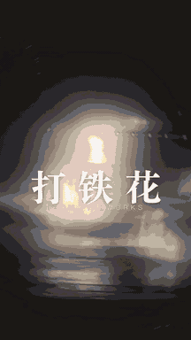

# beatcut



中文 | [English](#english)

把几段视频做成一条竖屏卡点短片。基于 colorize 的「黑白 → 彩色 + 丁达尔旋焦」引擎，再加上整条片子的节奏、音乐、字幕和特效。

- 整片按 BGM 拍点编排（默认 152 bpm，96 拍约 37.9 秒），所有切点踩在拍上
- 闪白开场 + 上色，慢放光轨，快切，旋焦过场，第二次上色，每拍一切，时间切片三联屏，铁花落下收尾
- 合成 BGM 全程不断，也可以换成自己的音乐
- 纯白字幕，5 种版式（竖排、左下双行、顶部收紧、斜向流星、底部逐字踩拍）加一种配音字幕
- 17 种剪映常用特效、9 种转场，可按拍点或区间叠加
- 可选配音（macOS `say`），配音时自动压低音乐和原声

## 安装

```bash
git clone <this repo> beatcut && cd beatcut
python3 -m pip install -r scripts/requirements.txt   # numpy, scipy, moderngl, Pillow, opencv
```

需要 `ffmpeg` / `ffprobe` 和支持 OpenGL 3.3 的环境。作为智能体技能使用时，把整个目录复制到 `~/.claude/skills/beatcut`（或 `~/.agents/skills`、`~/.codex/skills`）即可。

## 用法

```bash
# 快速预览
python3 scripts/make_reel.py a.mp4 b.mp4 c.mp4 -o out/p.mp4 --size 540x960 --beats 24 --crf 23

# 打铁花预设（字幕是为打铁花素材写的）
python3 scripts/make_reel.py a.mp4 b.mp4 c.mp4 d.mp4 -o out/reel.mp4 --preset datihua

# 自定义标题、字幕、特效、转场、配音
python3 scripts/make_reel.py a.mp4 b.mp4 -o out/r.mp4 --title "上海" --subtitle "SHANG HAI" \
  --caption "bloom:外滩@brk+0.2/1.5" --effect "glitch@52-68:beat:0.6" --transition whip \
  --voiceover "这是第一句@s2"

python3 scripts/make_reel.py --list     # 特效、转场、字幕版式、段落一览
```

输出末尾会打印 `VALIDATION=PASS` 和 `OUTPUT_VIDEO=<路径>`。校验只看数值：尺寸、时长、音轨、是否削波、是否爆音、音乐是否有断档。它不判断画面好不好看，成片请自己看一遍。

参数、段落表和 spec JSON 格式见 [SKILL.md](SKILL.md)，字幕风格守则见 [references/style-guide.md](references/style-guide.md)。

## 局限

- 配音和默认字体（宋体 SC、苹方 SC）依赖 macOS。其他系统用 `REEL_FONT_SERIF`、`REEL_FONT_SANS` 指定中文字体，这条路径没测过。
- 字幕版式是为竖屏 1080×1920 设计的，其他比例会按比例缩放，没逐一验证。
- `assets/effect_maps/` 中的颜色查找表与焦点遮罩取自剪映效果包，仅供学习研究。公开分发前请自行确认授权。
- 演示 GIF 和 `datihua` 预设使用打铁花素材。

## 测试

```bash
python3 -m pytest tests     # 单元测试 + 合成素材端到端
```

---

## English

Turn several clips into a beat-synced vertical reel. It builds on the colorize engine (black-and-white to color reveal with Tyndall spin focus) and adds pacing, music, captions and effects for the whole piece.

- The reel is planned on the BGM beat grid (default 152 bpm, 96 beats is about 37.9 s); every cut lands on a beat
- Flash opening with a color reveal, slow-motion light trails, quick plays, a spin-through bridge, a second reveal, one cut per beat, a time-slice triptych and a falling-spark finale
- A synthesized BGM that never goes silent, or bring your own music
- Flat white captions in 5 layouts (vertical column, lower-left lines, top contracting tracking, diagonal meteors, bottom stamped per beat) plus a voiceover subtitle
- 17 CapCut-style effects and 9 transitions, applied on beats or over a range
- Optional voiceover (macOS `say`) that ducks the music and footage audio

### Install

```bash
git clone <this repo> beatcut && cd beatcut
python3 -m pip install -r scripts/requirements.txt   # numpy, scipy, moderngl, Pillow, opencv
```

Needs `ffmpeg` / `ffprobe` and OpenGL 3.3. To use it as an agent skill, copy the folder to `~/.claude/skills/beatcut` (or `~/.agents/skills`, `~/.codex/skills`).

### Usage

```bash
# Fast preview
python3 scripts/make_reel.py a.mp4 b.mp4 c.mp4 -o out/p.mp4 --size 540x960 --beats 24 --crf 23

# Iron-fireworks preset (its captions are written for that footage)
python3 scripts/make_reel.py a.mp4 b.mp4 c.mp4 d.mp4 -o out/reel.mp4 --preset datihua

# Own title, caption, effect, transition and voiceover
python3 scripts/make_reel.py a.mp4 b.mp4 -o out/r.mp4 --title "Shanghai" --subtitle "SHANG HAI" \
  --caption "bloom:The Bund@brk+0.2/1.5" --effect "glitch@52-68:beat:0.6" --transition whip \
  --voiceover "First line@s2"

python3 scripts/make_reel.py --list     # effects, transitions, caption layouts, sections
```

The run ends with `VALIDATION=PASS` and `OUTPUT_VIDEO=<path>`. The check is numeric only: size, duration, audio track, clipping, clicks, and whether the music ever goes silent. It does not judge how the video looks, so watch the result yourself.

Options, the section table and the spec JSON format are in [SKILL.md](SKILL.md). The caption style rules are in [references/style-guide.md](references/style-guide.md).

### Limits

- Voiceover and the default fonts (Songti SC, PingFang SC) need macOS. Elsewhere set `REEL_FONT_SERIF` and `REEL_FONT_SANS` to a CJK font; that path is untested.
- Caption layouts are designed for 1080x1920 and scale to other sizes; not every size was checked.
- The color lookup tables and focus mask in `assets/effect_maps/` come from the Jianying (CapCut) effect pack and are for study and research only. Check the licensing yourself before redistributing.
- The demo GIF and the `datihua` preset use iron-fireworks footage.

### Tests

```bash
python3 -m pytest tests     # unit tests + an end-to-end run on synthetic clips
```
